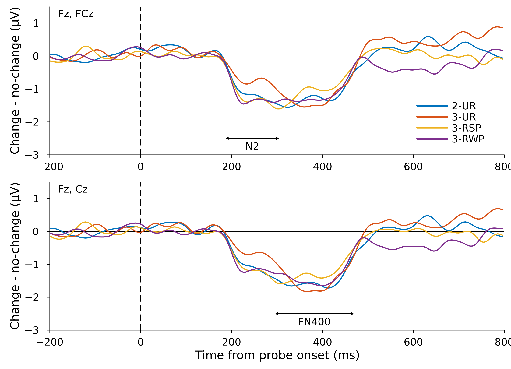
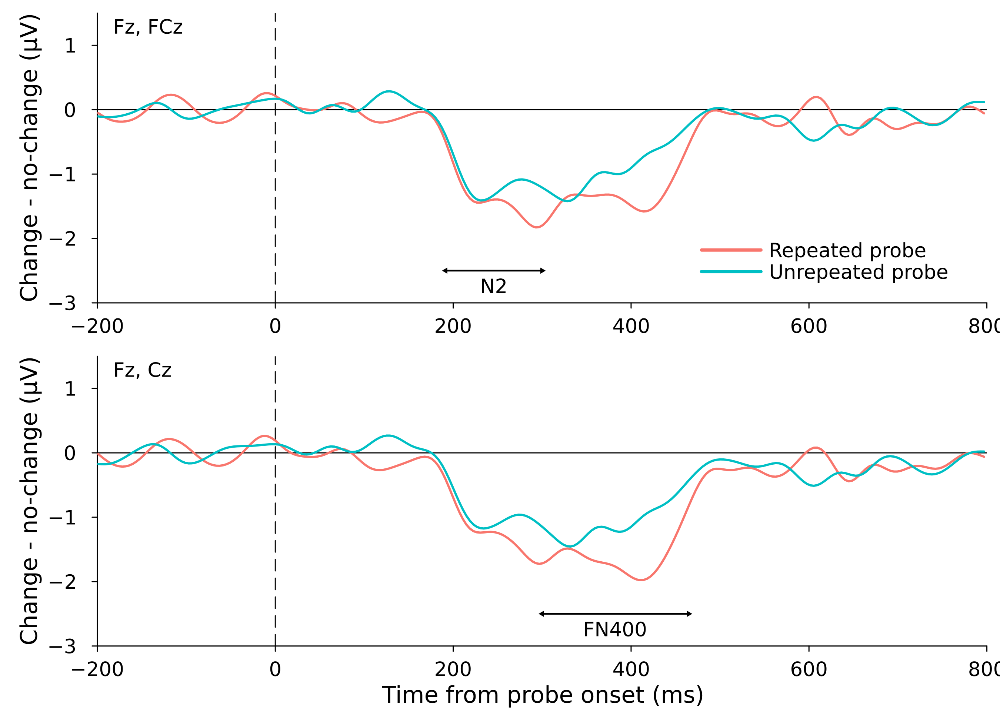

# Probe-locked ERPs in visual working memory: a Julia reanalysis

A Julia pipeline that reproduces the probe-locked analyses (N2pc, N2, FN400) of my open
EEG dataset [ds006979 on OpenNeuro](https://doi.org/10.18112/openneuro.ds006979.v1.1.4)
(version 1.1.4; Ramzaoui & Beck, *Scientific Reports*, Registered Report; Stage 1
accepted, Stage 2 under review), from the BIDS data and the ICA weights of the analysis.

It is the companion of [vwm-erp-julia](https://github.com/HananeRam/vwm-erp-julia),
which reproduces the stimulus-locked analyses (N2pc, CDA, negative slow wave, alpha), and
reuses its tested preprocessing code (`src/VWMPipeline.jl`).

In the task, a single-item probe appeared 1 s after the memory array; participants
reported whether its color had changed. Probe-locked ERPs index the comparison of the
probe with memory:

- **N2** (Fz, FCz) and **FN400** (Fz, Cz): change minus no-change difference waves, by
  stimulus type (2-UR, 3-UR, 3-RWP, 3-RSP) and, in the grouped arrays, by probe type
  (repeated vs. unrepeated item);
- **probe N2pc** (14 posterior channels): contralateral minus ipsilateral, change
  minus no-change.

All analyses use correct-response trials only, for the 53 participants of the original
probe-locked analyses.

## Figures

Produced by `scripts/03_measures_and_statistics.jl` (N = 53), in the design of Figures 5 and 6
of the paper: change − no-change difference waves, 20 Hz low-pass, N2 (Fz, FCz) on top and
FN400 (Fz, Cz) below, with the measurement windows.

**By stimulus type** (2-UR, 3-UR, 3-RSP, 3-RWP)



**By probe type** (repeated vs. unrepeated item)



## What is reproduced

| MATLAB / R step | What it does | Julia |
| --- | --- | --- |
| Scripts #1–#4 | Downsampling to 256 Hz, 0.1 Hz high-pass, ICA weights and removed components (`scripts/ICs_to_Remove.csv`), average-mastoid reference | `src/VWMPipeline.jl` (from vwm-erp-julia), `scripts/01_process_probe.jl` |
| Script #5, `BDF_probe.txt` | Probe bins: the probe code must be followed by 120 (correct), memory-array codes 51–58 ignored; epochs −200 to 800 ms, baseline −200–0 ms | `read_bdf`, `label_probe_trials`, `epoch` |
| Script #6c | N2/FN400 artifacts: saccades (step function on HEOG, −50–800 ms, 48 µV), ±200 µV and 150 µV moving-window peak-to-peak on Fz, FCz, Cz | `scripts/artifact_parameters_probe.csv` (from the `AR_*_N2_FN400_probe.xlsx` files) |
| Script #6b | Probe N2pc artifacts: saccades during the probe (−50–350 ms, 16 µV) and in the epoch (−200–400 ms, 64 µV), ±200 µV and 150 µV peak-to-peak on the 14 posterior channels and both HEOGs | same file (`AR_*_N2pc_probe*.xlsx`) |
| Script #7c, bin operations | Change − no-change waves (bins 46–49), trial-weighted averages (50–54), 2-UR and 3-UR (55–56); 20 Hz low-pass after the bin operations | `scripts/bin_operations.jl` (`bin_minus`, `wavgbin`, with ERPLAB's trial counts) |
| Script #7b, bin operations | Probe N2pc: contra/ipsi with equal hemifield weights, contra − ipsi, change − no-change, weighted averages | `n2pc_bins`, `contra_ipsi_probe` |
| ERP_Cluster_Analyses Steps 2–4 | `clustGND`: one-sample cluster permutation tests, 100–800 ms, 1000 permutations | `clustgnd`, `scripts/02_cluster_tests.jl` |
| Script #11c | Mean amplitude (N2 191.4–300 ms, FN400 300–464.8 ms, no low-pass); negative local peak latency (3-point neighbourhood, low-passed); 50% fractional peak onset latency (N2 91.4–300 ms, FN400 200–464.8 ms) | `meanbl`, `peaklatbl`, `fpeaklat`, ported from ERPLAB's `geterpvalues.m` and `localpeak.m` |
| R Steps 3–7 | Repeated-measures ANOVAs of Models 4–9 (with Greenhouse–Geisser correction when Mauchly's test is significant) and the exploratory 2 × 2 on onset latency | `rm_anova_gg`, `rm_anova_2x2`, `scripts/03_measures_and_statistics.jl` |

## Get the data

```bash
bash scripts/download_data.sh
```

This downloads the EEG files of the 53 participants (about 37 GB) and their ICA weights
(about 5.5 GB) into `data/ds006979`. Participant 3 needs the ICA weights of the reprocessed
analysis: until they are in the dataset derivatives, put the new
`3_allERPs_optimized_weights.set` in place of the old one. If vwm-erp-julia already downloaded some of
them, use the same folder: `DS006979=/path/to/data/ds006979 bash scripts/download_data.sh`,
and run the Julia scripts with the same `DS006979` variable.

## Run

```bash
julia --project=. -e 'using Pkg; Pkg.instantiate()'     # once
julia --project=. scripts/01_process_probe.jl           # preprocessing, artifacts, averages (~1–2 min per participant)
julia --project=. scripts/02_cluster_tests.jl           # cluster tests (time windows)
julia --project=. scripts/03_measures_and_statistics.jl # measures, ANOVAs, comparison, figures
```

## Outputs (`results/`)

| File | Content |
| --- | --- |
| `probe_trials.csv` | One row per probe: condition, cue, change, probe type, next event, artifact flags, kept trials per analysis |
| `probe_qc.csv`, `probe_bin_counts.csv` | Trials binned, rejected (per detector) and kept; accepted trials per bin and participant |
| `probe_erps.csv` | Participant averages per bin (no low-pass) |
| `cluster_tests.txt`, `cluster_tests.csv`, `cluster_tvalues.csv` | Cluster tests, Julia vs. MATLAB |
| `measures.csv` | Mean amplitude, peak latency and onset latency per participant and bin |
| `measures_julia_vs_matlab.csv`, `measures_comparison.csv` | The same, next to the MATLAB values, and agreement per bin |
| `anova.csv`, `anova_2x2_onset.csv`, `descriptives.csv` | Models 4–9 |
| `paper_comparison.txt` | Julia, the same statistics on the MATLAB measures, and the R output |
| `grand_averages.csv` | Grand averages |
| `Figure5_N2_FN400_StimulusType.png/.pdf`, `Figure6_N2_FN400_ProbeType.png/.pdf` | Figures 5 and 6 of the paper, same design as `Figures_N2_FN400_probe.m` (20 Hz low-pass, 300 dpi) |
| `n2pc_probe.png` | Probe N2pc grand average, same style (not in the paper) |

## Validation

Run on ds006979 version 1.1.4 with the ICA weights of the analysis, for the 53 participants of
the probe-locked analyses, against the MATLAB/ERPLAB analysis (blink components of
`ICs_to_Remove.xlsx` removed for every participant). "MATLAB" is the same statistics
applied to the MATLAB measurement files (Script #11c output, `reference/measurements`): no
MATLAB code is run, so any difference comes from the measures, not from the statistics software.

| Step | Julia vs. MATLAB/ERPLAB |
| --- | --- |
| Cluster tests (N = 53) | N2 191.4–449.2 ms, FN400 195.3–464.8 ms, no probe N2pc cluster: identical |
| Peak latencies | 1,060 / 1,060 identical |
| Onset latencies | 970 / 975 identical (the others differ by one sample, 3.9 ms) |
| Mean amplitudes | mean difference 0.0013–0.0017 µV, max 0.065 µV (MATLAB rounds to 3 decimals) |

| Model | Julia (N = 53) | MATLAB (N = 53) | Reproduced |
| --- | --- | --- | --- |
| N2 amplitude, stimulus type (5.a) | F(3, 156) = 1.13, p = .340 | F(3, 156) = 1.12, p = .342 | Yes |
| N2 peak latency, stimulus type (5.b) | F(3, 156) = 0.76, p = .516 | F(3, 156) = 0.76, p = .516 | Yes |
| FN400 amplitude, stimulus type (6.a) | F(2.38, 123.67) = 0.19, p = .866 | F(2.38, 123.67) = 0.19, p = .865 | Yes |
| FN400 peak latency, stimulus type (6.b) | F(3, 156) = 1.08, p = .357 | F(3, 156) = 1.08, p = .357 | Yes |
| N2 amplitude, probe type (8.a) | F(1, 52) = 0.32, p = .574 | F(1, 52) = 0.32, p = .573 | Yes |
| N2 peak latency, probe type (8.b) | F(1, 52) = 3.63, p = .062 | F(1, 52) = 3.63, p = .062 | Yes |
| FN400 amplitude, probe type (9.a) | F(1, 52) = 1.60, p = .211 | F(1, 52) = 1.61, p = .210 | Yes |
| FN400 peak latency, probe type (9.b) | F(1, 52) = 0.26, p = .610 | F(1, 52) = 0.26, p = .610 | Yes |
| N2 onset latency, probe type (4.b) | F(1, 39) = 0.07, p = .799 | F(1, 39) = 0.07, p = .799 | Yes |
| FN400 onset latency, probe type (4.c) | F(1, 28) = 0.96, p = .336 | F(1, 28) = 0.94, p = .340 | Yes |
| N2 onset latency, probe × proximity (exploratory) | probe F(1, 39) = 3.10, p = .086; proximity F = 0.01, p = .917; interaction F = 1.35, p = .252 | same | Yes |
| FN400 onset latency, probe × proximity (exploratory) | probe F(1, 28) = 0.45, p = .510; proximity F = 2.72, p = .110; interaction F = 0.21, p = .648 | same | Yes |

## Notes

- **Dataset version.** Use the latest version of the dataset, 1.1.4: it contains all the
  corrections to the dataset and its files.

## License

MIT. The data are CC0 (OpenNeuro ds006979).
